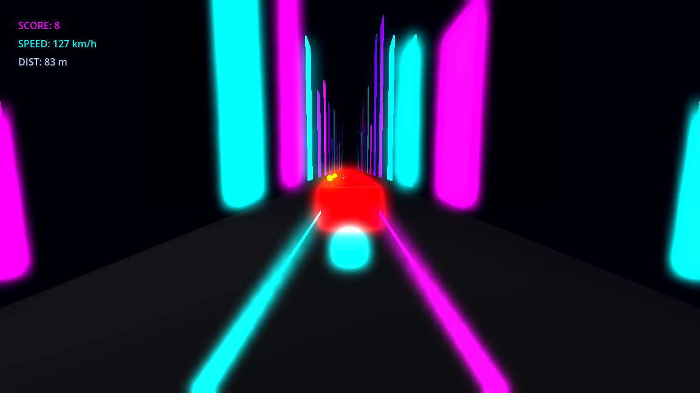
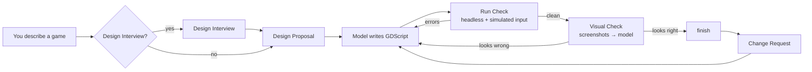

<div align="center">

# 🎮 OpenGames

**Describe a game. Get a playable Godot project. Keep improving it by talking to it.**

An open-source, model-agnostic agent harness that designs, builds, play-tests and iterates on
Godot 4 games: 2D or 3D, any genre. It is built to run on open-weight models.

[](LICENSE)
[](https://godotengine.org)
[](https://www.python.org)
[](https://ollama.com)
[](#)



<sub><b>Neon Runner</b>, a 3D endless runner built from one paragraph by <code>gemma4:31b-cloud</code>. It fixed its own script errors, then reworked the visuals after seeing screenshots of the running game.</sub>

</div>

---

## ✨ What it does

| | |
|---|---|
| 🗣️ **Design Interview** | Optionally interviews you about the design (with a recommended answer for every question) until you accept a **Design Proposal**. |
| 🛠️ **Build** | The model writes GDScript that builds the whole game in code: no assets needed, any genre, 2D or 3D. |
| 🧪 **Run Check** | Runs the game headless for 30 s of game time while pressing random keys, clicking and moving the mouse. Script errors go straight back to the model, which fixes them. |
| 👀 **Visual Check** | Renders the game for real and shows screenshots to the model, which compares them with the design and fixes black screens, bad cameras or missing HUD. |
| 🔁 **Change Requests** | Once the game is built, keep talking: add features, change things, or report bugs you found while playing. |
| 🔌 **Any model** | One OpenAI-compatible client works with Ollama, vLLM, LM Studio, OpenRouter and others. Defaults to an open-weight model via Ollama. |
| 📜 **Full trace** | Every model step, tool call and check is shown live and saved to `out/.sessions/`. |

## 🚀 Quick start

```bash
git clone https://github.com/yatharthjag2008/OpenGames.git && cd OpenGames

# 1. Godot 4 (Linux shown; or set GODOT=/path/to/godot)
mkdir -p tools && curl -L -o /tmp/godot.zip \
  https://github.com/godotengine/godot/releases/download/4.7.2-stable/Godot_v4.7.2-stable_linux.x86_64.zip \
  && unzip /tmp/godot.zip -d tools && mv tools/Godot_v4.7.2-stable_linux.x86_64 tools/godot

# 2. An open-weight model via Ollama
ollama pull gemma4:31b-cloud

# 3. Start talking
python3 harness.py
```

## 🕹️ Usage

`python3 harness.py` starts a conversation. Describe a game and OpenGames interviews you about the
design, shows you a Design Proposal, and builds it once you accept. Then keep talking: ask for
features, report bugs you found while playing, or switch to another game.

```
› a 3D marble maze with a timer
  Q1 - Camera: tilt the maze (Monkey Ball style) or roll the marble directly?
    Recommended: tilt the maze with WASD
  ...
› yes
  # Marble Maze ...  Accept this design?
› yes
  TOOL create_game · write_file · RUN CHECK ✓ · VISUAL CHECK · FINISHED
marble-maze › the marble is too fast, and add a second level
```

```bash
python3 harness.py                         # start a conversation
python3 harness.py "a pong game"           # start with a first message
python3 harness.py --open marble-maze      # pick up where you left off
```

| Command | |
|---|---|
| `/games` | List games in `out/` |
| `/open <name>` | Switch to a game |
| `/play` | Launch the open game in a window |
| `/files` | List the open game's files |
| `/grill on\|off` | Turn the Design Interview on or off (or just say "just build it") |
| `/model <name>` | Switch model mid-conversation |
| `/new` | Start a fresh conversation |
| `/quit` | Exit |

Games are written to `out/<name>/`. Open `project.godot` in the Godot editor to inspect them or export them.
Every session is logged to `out/.sessions/<timestamp>.jsonl`.

### Options

| Flag | Default | |
|---|---|---|
| `--model` | `gemma4:31b-cloud` | Any model name your endpoint serves |
| `--base-url` | `http://localhost:11434/v1` | Any OpenAI-compatible endpoint |
| `--api-key` | `ollama` | API key for hosted endpoints |
| `--godot` | `tools/godot` | Path to the Godot 4 binary |
| `--open` | | Start with an existing game open |
| `--no-grill` | | Skip the Design Interview |
| `--no-visual` | | Skip the Visual Check (for no display, or a text-only model) |
| `--frames` | `1800` | Frames at 60 fps per Run Check |
| `--max-steps` | `40` | Agent steps per message |

All of these can also be set with the environment variables `HARNESS_MODEL`, `HARNESS_BASE_URL`, `HARNESS_API_KEY` and `GODOT`.

## ⚙️ How it works



The model gets a small toolset: `create_game`, `open_game` and `list_games` to manage games, and
`write_file`, `read_file`, `list_files`, `run_game`, `play_game` and `finish` to work on one.
`project.godot` and `main.tscn` are owned by the harness, so the model can't corrupt them.
`finish` is **rejected** unless the latest Run Check was clean, so the model can't call a broken game done.
Keeping the toolset small helps open-weight models stay reliable.

Long sessions stay fast: old file contents and screenshots are removed from the model's history,
and the model can always `read_file` to see the current state.

## 🧠 Models

The demo default is **Gemma 4 31B**, an open-weight model that's free on Ollama Cloud.

```bash
python3 harness.py --model qwen3.8:27b                                   # local, fully offline
python3 harness.py --base-url https://openrouter.ai/api/v1 \
    --api-key $OPENROUTER_API_KEY --model qwen/qwen3-coder                # hosted
```

The Visual Check needs a model that can see images. Use `--no-visual` for text-only models.

## 📁 Repository layout

```
harness.py        the whole harness (Python standard library only)
input_sim.gd      random keys/clicks/mouse injected during Run Checks
capture.gd        screenshot autoload injected during Visual Checks
template/         minimal Godot 4 project every game starts from
examples/         games generated by the harness
GLOSSARY.md       domain language (Harness, Run Check, Change Request, ...)
docs/adr/         architecture decisions
```

## 📄 License

[MIT](LICENSE). Generated games are yours.
